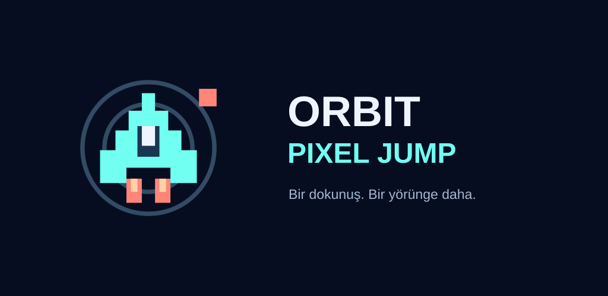

# Orbit Pixel Jump

Flutter ve Flame ile geliştirilmiş, neon görünümlü tek dokunuşlu bir yörünge oyunu.

**One-tap orbital arcade game built with Flutter and Flame.** Jump between orbits, avoid obstacles, and advance through increasingly difficult sectors.



## Oynanış

- Ekrana dokunarak bir dış yörüngeye atla ve engellerden kaçın.
- Beşinci yörüngeye ulaştığında yeni sektöre geç; skorunu geliştirmeye devam et.
- Artan hız, piksel parçacıkları, ses efektleri ve kamera sarsıntısı.
- Yerel yüksek skor ve ses tercihleri; duraklatma ve yeniden başlatma.
- Android'de banner, geçiş ve ödüllü reklam entegrasyonu. Geliştirme yapılandırması test reklamlarını kullanır.

## Çalıştırma

Flutter SDK (Dart 3.12 veya üzeri), Android için Android SDK ve JDK 17+ gerekir. Bağımlılık sürümleri `pubspec.lock` içinde kayıtlıdır.

```sh
git clone https://github.com/EmreMhir/orbit-pixel-jump.git
cd orbit-pixel-jump
flutter pub get
flutter run
```

Android cihaz/emülatör için `flutter run`, tarayıcı önizlemesi için `flutter run -d chrome` kullanılır. Web önizlemesi Android reklam akışının doğrulaması değildir.

```sh
flutter analyze
flutter test
flutter build apk --debug
flutter build web --release
```

## Kaynak yapısı

| Klasör | İçerik |
| --- | --- |
| `lib/game/` | Oyun döngüsü, bileşenler, menüler ve HUD |
| `lib/core/` | Oyun kuralları, ayarlar ve yerel kayıt |
| `lib/managers/` | Ses, reklam ve UMP entegrasyonu |
| `lib/screens/` | Gizlilik giriş ekranı |
| `assets/` | Sesler, fontlar ve geliştirme gizlilik metni |
| `android/`, `web/` | Platform yapılandırmaları |
| `test/` | Oyun akışı, başlangıç, kurallar ve reklam izni testleri |
| `tool/` | Ses üretimi ve Android yayın aracı |

## Yayın yapılandırması

Bu depo geliştirme için hazırlanmıştır. Gerçek reklam kimlikleri, kişisel iletişim bilgileri ve imzalama anahtarları dahil değildir. `example.com` adresleri açıkça örnek değerlerdir; çalışan destek veya gizlilik adresleri değildir. Mağaza sürümü oluşturmadan önce [yayın notlarını](docs/RELEASE_TR.md) izleyin.

Sesleri yeniden üretmek için `dart run tool/generate_audio.dart` kullanılabilir. Press Start 2P ve Space Grotesk fontlarının lisansları `assets/fonts/` içindedir. Projenin tamamı için ayrıca bir açık kaynak lisansı belirtilmemiştir.

Diğer oyun: [Hadal Line: Endless Descent](https://github.com/EmreMhir/hadal-line).
